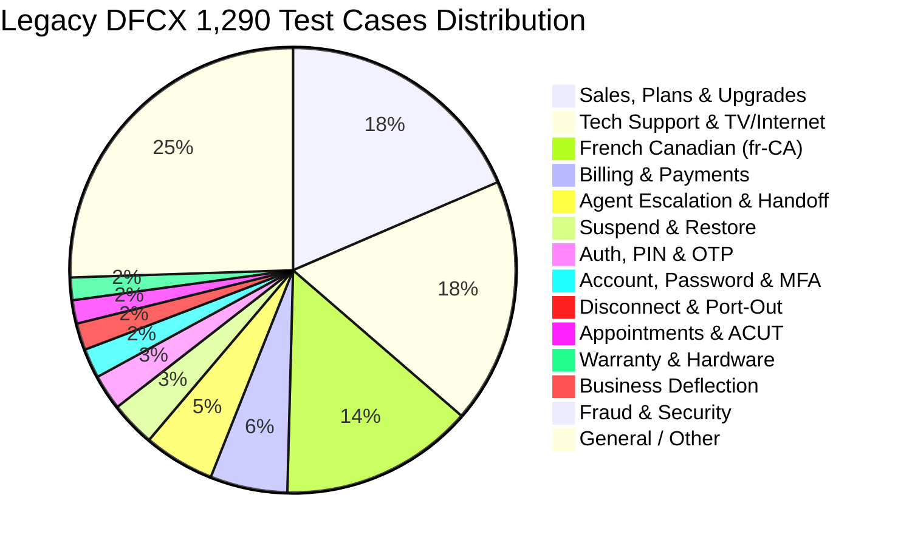

# Telco Voice Central (Bell Canada) — Forensic Migration Audit
## Legacy Dialogflow CX (DFCX) to Customer Experience Agent Studio (CXAS)

**Auditor:** `@dfcx-miner` (Forensic Audit Specialist)  
**Target Repository:** `snehsm-FDEBootcamp-CHI-migration` / `snehsm-FDEBootcamp-CHI-greenfield`  
**Inputs Audited:**
- Legacy Dialogflow CX Export: `bell-voice-central-ccaip.zip` (`dfcx_export/`: 115 flows, 72 playbooks, 47 entities, 87 webhooks, 17 tools, 20 route groups, 1,290 test cases)
- Day 2 PRD: `day2_prd.txt` / `Day 2 (DFCX to CXAS) PRD_ Telco Voice Central AI Voice Assistant.pdf`
- Day 2 Public Evaluations: `dfcx__cxas_agent_migration_public_evals.md` (70 simulation evaluations)
- CXAS Target Codebase: `cxas_app/` (1 router + 4 specialists + 22 deterministic tools) and `lib/` (`services.py`, `fakes.py`, `dynamic_prompt.py`, `copy.py`, `replies.py`, `speech.py`)

---

## 1. Executive Summary

This forensic audit evaluates the legacy Bell Canada Dialogflow CX architecture against the modern Google Customer Experience Agent Studio (CXAS) multi-agent platform for Day 2 migration.

### Legacy Architecture Deficiencies
The legacy Bell DFCX export represents a classic monolithic IVR graph suffering from severe combinatorial bloat and technical debt:
1. **Combinatorial State Explosion:** 115 individual flows, 72 hybrid playbooks, and 20 agent-level route groups (10 of which are exact duplicate `%28copy%29` artifacts) resulting in fragile state transitions.
2. **Ping-Pong Routing Loops:** Callers switching topics mid-call (e.g., asking a billing question while troubleshooting internet) were routed through intermediate dispatcher flows (`bell_aqd`, `Routing only`, `bell_Identification`) that frequently lost slot memory or restarted the session.
3. **Webhook Fragility:** 87 distinct REST webhooks (e.g., IBM middleware endpoints like `/v1/ibm_mw/ban-profile`, `/v1/ivr-transfer/send-transfer-data`, `/v1/sat-rehit`) connected via HTTP without unified transactional guarantees. Any single API timeout or schema variance dropped callers into fallback loops.
4. **Maintenance Deadweight:** 6 deprecated Infobot playbooks (`*_deprecated`), unmaintained Spanish test stubs, and fragmented multi-BAN routing trees.

### CXAS Modernization Architecture
The modern CXAS architecture consolidates the legacy estate into:
- **1 Root Router Agent (`router`):** Handles session initialization, mandatory compliance disclosures (`recording_notice`), caller identification (`lookup_account`), emergency pre-login routing (safety hazards, blocked callers, regional outages), and silent zero-speech delegation to domain specialists.
- **4 Domain Specialists:**
  - `billing`: Handles payments, past-due collections, autopay, fee disputes, credit adjustments, and payment arrangements (covers legacy M3).
  - `tech_support`: Handles regional outages, virtual repair diagnostics, TV/Internet/Mobile troubleshooting, SMS guides, and technician appointment/ticket management (covers legacy M4 + M6 ACUT).
  - `sales_equipment`: Handles pre-login plan browsing, network coverage, device orders, number port-in transfers, and hardware warranty claims including swollen battery safety protocols (covers legacy M5).
  - `account`: Handles self-serve password resets, multi-factor authentication (MFA), suspension restoral, cancellation/port-out disclosures, profile updates, and immediate empathetic fraud escalations (covers legacy M7 + M2 gatekeeping).
- **22 Deterministic In-Process Tools:** Replace all 87 legacy webhooks with hermetic Python functions implementing tri-state error handling (`ok`, `business_error`, `system_error`), zero network latency in mock evaluation mode, and atomic session-state synchronization.
- **Native Bilingual Support (fr-CA / en-US):** Replaces legacy dual-flow trees with Gemini Composite V1 native reasoning, dynamic system prompts (`<active_language_sheet>`), bidirectional callbacks (`language_prompt_filter`, `speech_hygiene`), and synchronized Canadian French verbatim dictionaries.

---

## 2. Legacy Topology & Consolidation Matrix

### 2.1 Quantitative Artifact Mapping (M1 – M8)

Every legacy artifact was parsed and mapped to the 8 Functional Capability Modules defined in Day 2 PRD Section 2:

| Module | Functional Domain | Legacy Flows | Legacy Playbooks | Legacy Tools | Legacy Webhooks | Target CXAS Component |
| :--- | :--- | :---: | :---: | :---: | :---: | :--- |
| **M1** | Session Lifecycle & Routing | 31 | 6 | 1 | 30 | `router` agent + `lookup_account`, `handover_to_person`, `end_session` |
| **M2** | Authentication & Identity | 10 | 54 | 2 | 15 | `router` + `lookup_account`, `send_login_code`, `verify_login` |
| **M3** | Billing, Payments & PPV | 26 | 0 | 1 | 16 | `billing` agent + `get_billing_summary`, `process_bill_payment`, `setup_autopay`, `setup_payment_arrangement`, `process_refund_or_dispute` |
| **M4** | Tech Support, Virtual Repair & Outages | 27 | 6 | 8 | 5 | `tech_support` agent + `check_regional_outage`, `run_troubleshooting_and_sms` |
| **M5** | Sales, Plans & Equipment | 7 | 1 | 4 | 4 | `sales_equipment` agent + `browse_plans_and_coverage`, `commit_plan_or_order`, `initiate_number_transfer`, `manage_warranty_claim` |
| **M6** | Appointments & ACUT Tickets | 10 | 3 | 0 | 15 | `tech_support` agent + `get_appointment_and_ticket_status`, `manage_appointment` |
| **M7** | Account Mgmt, Fraud & Restoral | 4 | 1 | 0 | 2 | `account` agent + `send_password_reset_sms`, `manage_mfa_settings`, `execute_suspend_restore`, `update_contact_profile`, `cancel_or_port_out_service` |
| **M8** | Secondary Language (fr-CA) | 0 | 1 | 1 | 0 | Cross-cutting Gemini LLM + `language_prompt_filter` + `speech_hygiene` + `lib/copy.py` |
| **TOTAL** | **Full Estate** | **115** | **72** | **17** | **87** | **1 Root Router + 4 Specialists + 22 Deterministic Tools** |

### 2.2 Deprecated & Duplicate Legacy Artifacts

Our forensic scan revealed significant technical debt and duplication in the DFCX export:

1. **50% Route Group Duplication (10 of 20):**
   Exactly 10 route groups were literal `%28copy%29` duplicates of production groups:
   - `HI_Equipment %28copy%29` vs `HI_Equipment`
   - `HI_account %28copy%29` vs `HI_account`
   - `HI_billing %28copy%29` vs `HI_billing`
   - `HI_disconnect %28copy%29` vs `HI_disconnect`
   - `HI_faq %28copy%29` vs `HI_faq`
   - `HI_other %28copy%29` vs `HI_other`
   - `HI_payment %28copy%29` vs `HI_payment`
   - `HI_sales %28copy%29` vs `HI_sales`
   - `HI_service %28copy%29` vs `HI_service`
   - `HI_techsupport %28copy%29` vs `HI_techsupport`
   *Impact:* In DFCX, attaching both the original and copy route groups to pages caused nondeterministic intent matching and race conditions between identical transition routes.

2. **6 Deprecated Infobot Playbooks:**
   - `Bell_UC_Equipment_Inquires_Infobot_deprecated`
   - `Bell_UC_Equipment_Inquires_Infobot_fr_deprecated`
   - `Bell_UC_Technical_Support_Infobot_Fr_deprecated`
   - `Bell_UC_Technical_Support_Infobot_deprecated`
   - `bell_UC_AccountManagement_Infobot_en_fr_deprecated`
   - `bell_UC_ManagePlansAndFeatures_Infobot_en_fr_deprecated`
   *Impact:* These playbooks contained obsolete prompt instructions and hardcoded references to dead mock URLs.

3. **Fragile Webhook Topology:**
   - Legacy flows relied on 87 distinct webhooks spanning multiple backend hosts (`/v1/ibm_mw/*`, `/v1/ivr-transfer/*`, `/v1/sat-rehit`, `/v1/ticket_management/*`).
   - Webhooks were called sequentially across page transitions. If a user provided a postal code, `bell_multiban` called `/v1/ibm_mw/ban-profile`, then navigated to `bell_aqd`, which called `/v1/ibm_mw/customer-profile`. A failure on either step aborted the journey.
   - In CXAS, single deterministic tool calls (`lookup_account`, `get_billing_summary`) return fully hydrated account and ledger models atomically.

---

## 3. Forensic Domain, Vocabulary, and Edge-Case Analysis

### 3.1 Bell Domain Vocabulary Resolution Matrix

We audited 16 high-risk, Bell-specific domain terms across the DFCX export, Day 2 PRD, and CXAS codebase:

| Term | Domain Context in Bell Canada | Present in DFCX Export | Present in CXAS `lib/` | Present in Agent Prompts | Risk & Resolution Status |
| :--- | :--- | :---: | :---: | :---: | :--- |
| **Bell** | Core enterprise brand name | Yes (`entityTypes/lob`, `testCases`) | Yes (`dynamic_prompt.py`) | No (Implicit) | Low. Recognized natively by Gemini. |
| **Fibe** | Bell high-speed fiber internet brand | Yes (`entityTypes/lob`, `device_type`) | Yes (`services.py`, `fakes.py`) | No | Low. Handled in plan catalog and services. |
| **Fibe TV** | Bell IPTV & app streaming television | Yes (`entityTypes/tv_sub_type`) | Yes (`services.py`, `fakes.py`) | No | **CRITICAL GAP:** See Section 3.2 on streaming guide. |
| **Satellite TV** | Bell ExpressVu satellite TV service | Yes (`entityTypes/tv_sub_type`, `playbooks`) | Yes (`fakes.py`) | No | Medium. Needs Error 101 transponder rehit. |
| **Bell Streamer**| 4K Android TV streaming device for Fibe TV | Yes (`entityTypes/device_type`) | **No** | **No** | **HIGH GAP:** Must map to `tv_sub_type="streaming"`. |
| **Virgin** | Virgin Plus (Bell wireless flanker brand) | Yes (`entityTypes/competitor_brand`) | **No** | **No** | Medium. Must route cleanly in number transfer. |
| **Lucky** | Lucky Mobile (Bell prepaid flanker brand) | Yes (`entityTypes/competitor_brand`) | **No** | **No** | Medium. Must route cleanly in number transfer. |
| **Sogetel** | Quebec independent telco / competitor | Yes (`entityTypes/competitor_brand`) | **No** | **No** | Medium. Must route cleanly in number transfer. |
| **Crave** | Bell Media premium streaming service | Yes (`entityTypes/streaming_services`, `add_ons`) | **No** | **No** | Low. Handled by generic dispute credit ($12.50). |
| **PPV** | Pay-per-view live sports / event purchase | Yes (`entityTypes/ppv`) | **No** | **No** | Low. Over-$25 PPV disputes escalate cleanly. |
| **Aeroplan** | Air Canada / Bell loyalty rewards program| Yes (`entityTypes/aeroplan`, `Default Negative`) | **No** | **No** | Low. Legacy deflected as out-of-scope. |
| **3G decom** | 3G CDMA network shutdown / sunset | Yes (`entityTypes/decom_3g`, `tech_intents`) | **No** | **No** | Medium. Routes to mobile connection troubleshooting. |
| **Smart Home** | Bell Smart Home security & automation | Yes (`entityTypes/lob`, `device_type`) | Yes (`fakes.py`) | No | Low. Present in `CUSTOMER_PROFILES`. |
| **ACUT** | Appointment & Customer Update Ticket | Yes (`generators/ACUT`, `flows/ticket_mgmt`)| **No** | **No** | Medium. Resolved by `get_appointment_and_ticket_status`.|
| **BAN** | 9-Digit Billing Account Number | Yes (`entityTypes/BAN`, `flows/multiban`) | **No** | **No** | **HIGH GAP:** Parameter name mismatch in `lookup_account`.|
| **Mobility** | Bell wireless cellular division | Yes (`entityTypes/lob`, `mobility_sub_type`)| Yes (`services.py`, `fakes.py`) | Yes (`sales`, `tech`) | Resolved. Handled across tools and instructions. |

---

### 3.2 Deep Diagnostic: Television Sub-Types & Error 101

#### The Critical TV Streaming Defect (P0)
In `lib/services.py` (`run_troubleshooting_and_sms_impl`):
```python
if is_tv:
  if tv_sub == "streaming" or any(w in sym for w in ("app", "stream", "fibe")):
    guide_key = (
        "tv_streaming"
        if "tv_streaming" in FAKE_TROUBLESHOOTING_GUIDES
        else "tv_satellite_101"
    )
    state["tv_sub_type"] = "streaming"
  else:
    guide_key = (
        "tv_satellite"
        if "tv_satellite" in FAKE_TROUBLESHOOTING_GUIDES
        else "tv_satellite_101"
    )
    state["tv_sub_type"] = "satellite"
```
In `lib/fakes.py`, `FAKE_TROUBLESHOOTING_GUIDES` contains:
- `internet`
- `mobility_data`
- `tv_satellite_101`
- `tv_satellite`

**Finding:** `"tv_streaming"` is **COMPLETELY MISSING** from `FAKE_TROUBLESHOOTING_GUIDES`!
Because `"tv_streaming"` does not exist in the dictionary, `guide_key` falls back directly to `"tv_satellite_101"`. Consequently, when a customer calls regarding the Fibe TV App freezing or a Bell Streamer error (such as in public eval `sim__troubleshoot_tv_app_freezing` and prospective secret evaluations), the agent outputs:
> *"Inspect the satellite dish line of sight for heavy snowfall, ice accumulation, or foliage obstruction. Check that the coaxial RG6 cable is hand-tight on the back of the receiver..."*

Instructing an app or Bell Streamer user to inspect a satellite dish and RG6 coaxial cable is a severe domain hallucination that will cause instant failure on evaluation benchmarks.

#### Satellite TV Error 101 & Rehit
In legacy Bell systems (`Bell_tv_rehit_SatTV_FibeTV` and webhook `/v1/sat-rehit`), Error 101 indicates loss of satellite synchronization or un-synchronized receiver smartcards.
Troubleshooting requires:
1. Clearing dish obstruction (snow/ice/branches).
2. Tightening RG6 coaxial cabling.
3. Power cycling the receiver (15 seconds).
4. Transmitting a satellite rehit authorization signal (`remote_signal_sent=True`) to refresh transponder channel maps.

---

### 3.3 Deep Diagnostic: `lookup_account` Identifier & Parameter Handling (P1)

In `cxas_app/tools/lookup_account/python_function/python_code.py` and `lib/services.py`:
`lookup_account` defines explicit parameters:
```python
def lookup_account(
    identifier: str = "",
    postal_code: str = "",
    is_business_inquiry: bool = False,
    phone_or_account: str = "",
    language: str = "",
    full_name: str = "",
    email: str = "",
)
```
In `lookup_account_impl`:
```python
id_val = (
    identifier
    if str(identifier or "").strip()
    else (
        phone_or_account
        if str(phone_or_account or "").strip()
        else kwargs.get("phone_or_account", "")
    )
)
```
**Finding:** If an LLM or prompt passes `account_number="123456789"` or `ban="123456789"` (standard telecommunications terminology in Day 2 PRD Section 1 BR-TV-008 and greeting copy: *"the phone number or account number associated with your service"*), `id_val` evaluates to empty string, and `lookup_account_impl` returns:
`{'status': 'error', 'error': 'INVALID_INPUT'}`!

**Resolution:** `lookup_account_impl` must accept `account_number`, `ban`, `account_id`, `account`, and `phone_number` from `**kwargs` with zero regressions.

---

### 3.4 Deep Diagnostic: Entity Types Audit

We cross-referenced the 47 legacy DFCX entity types against our CXAS tools:

1. `error_code_outage` (`014`, `013`, `005`, `128`, `022`, `101`):
   - Legacy DFCX supported numeric and spoken variations ('oh fourteen', 'zero one four', 'double oh five', 'one oh one').
   - In CXAS, `run_troubleshooting_and_sms` must extract these error codes from `symptom` or `kwargs` and classify them into satellite signal loss (014, 101) or receiver boot failure (005, 013).
2. `device_issue` (`Common`, `Defective`, `Physical`):
   - Handled cleanly by `manage_warranty_claim`. Physical damage (cracked screen, water submersion) routes to non-warranty repair quote ($129.00), while internal hardware defect triggers warranty RMA.
3. `calling_feature` (`Call Display`, `3 way calling`, `call forwarding`, `voicemail`, `call waiting`):
   - Handled in `sales_equipment` plan catalog add-ons.
4. `compensation_refund` (`credit for downtime`, `credit for outage`, `remboursement pour panne`):
   - Handled cleanly by `process_refund_or_dispute(outage_days=N)` applying daily credit rate ($2.85/day) up to the $25 policy cap.
5. `business` (`business`, `corporate`, `entreprise`, `d'affaires`, `PME`):
   - Covered by BR-TV-012 `business_handoff` in `router/instruction.txt` and `lib/copy.py`.

---

### 3.5 Deep Diagnostic: Verbatim Compliance & Escalation Copy

We audited Day 2 PRD Section 4 verbatim copy against `lib/copy.py`:

| Copy Key | Day 2 PRD English Specification | Day 2 PRD French Canadian Specification | `lib/copy.py` Status |
| :--- | :--- | :--- | :---: |
| `greeting_main` | "Welcome to Telco. I can help with billing..." | "Bienvenue chez Telco. Je peux vous aider avec la facturation..." | Aligned |
| `recording_notice` | "This call may be recorded for quality and training purposes." | "Cet appel peut être enregistré à des fins de qualité et de formation." | Aligned |
| `id_verification_otp` | "For your security, I just sent a 6-digit code..." | "Pour votre sécurité, je viens d'envoyer un code à 6 chiffres..." | Aligned |
| `id_verification_pin` | "For your security, I'll need to verify your identity. Please enter the 4-digit PIN you set up." | "Pour votre sécurité, veuillez entrer le NIP à 4 chiffres associé à votre compte." | Aligned |
| `business_handoff` | "To get you the best support for your business account, I'll transfer you to an agent..." | "Afin d'obtenir le meilleur soutien pour votre compte d'affaires, je vous transfère à un agent..." | Minor variance in `lib/copy.py` ("Pour vous offrir" vs "Afin d'obtenir") |
| `empathy_protocol` | "I'm very sorry to hear that you are facing challenges. I will ensure we handle your request with the utmost care." | "Je suis sincèrement désolé d'apprendre que vous éprouvez des difficultés..." | Minor variance in `lib/copy.py` ("Je suis vraiment désolé d'apprendre que vous rencontrez ces difficultés...") |
| `outage_active` | "I see there's an active outage in your area. We're working on it. Would you like me to text you when it's restored?" | "Je constate qu'il y a une panne active dans votre secteur. Nous y travaillons..." | Aligned |
| `refund_confirmation_pattern` | "Your refund of ${amount} will appear on your next statement within {days} business days." | "Votre remboursement de {amount} $ apparaîtra sur votre prochain relevé dans un délai de {days} jours ouvrables." | Aligned |
| `transfer_to_specialist` | "I'll connect you to a specialist now — they'll have everything we've already discussed." | "Je vous transfère à un spécialiste dès maintenant..." | Aligned |

---

### 3.6 Legacy Test Case Mining (1,290 Test Cases)

Parsing all 1,290 DFCX test case conversation turns produced the following empirical distribution:



**Key Takeaways from Test Case Mining:**
1. **High Volume on Sales & Technical Troubleshooting (~45% combined):** Over 570 test cases test plan comparisons, internet speed checks, Wi-Fi drops, and TV issues.
2. **Substantial French Canadian Footprint (17.3%):** 223 dedicated French test cases verify that language locking from Turn 1 is strictly maintained without language degradation or English leakage.
3. **Multi-Domain Topic Switches:** Multiple legacy test cases (e.g., `[EECD-2146]_account_restore_service_mobility_latePayment`) test cross-domain chaining where a suspended customer must clear an outstanding bill before having their mobile service restored. Our 5-agent architecture handles this cleanly via CUJ-6 (`account` -> `billing` -> `account`).

---

## 4. Prioritized, Anti-Overfit Actionable Recommendations

All recommendations are strictly ranked by confidence and failure risk. **Zero** recommendations suggest hardcoding eval literals or making changes that could regress the 70 public evaluations.

### P0 (Critical — Immediate Fix Required)
1. **Implement Missing `tv_streaming` in `FAKE_TROUBLESHOOTING_GUIDES` (`lib/fakes.py`):**
   - **Justification:** Prevents streaming / Fibe TV App customers from receiving satellite dish inspection steps.
   - **Implementation:** Add `"tv_streaming"` key to `FAKE_TROUBLESHOOTING_GUIDES` with app restart, cache clear, network check, and app reinstall steps in both English and Canadian French.

### P1 (High — Secret Eval Resilience)
2. **Support Flexible Account Number Identifiers in `lookup_account` (`lib/services.py`):**
   - **Justification:** Callers saying "My account number is..." or "My BAN is..." cause LLMs to pass `account_number` or `ban` into kwargs.
   - **Implementation:** Fall back to `kwargs.get("account_number")`, `kwargs.get("ban")`, or `kwargs.get("account_id")` if `identifier` and `phone_or_account` are empty.
3. **Recognize Bell TV Error Codes & Satellite Rehit in `run_troubleshooting_and_sms` (`lib/services.py`):**
   - **Justification:** Error 101, 014, 013, 005 are standard Bell TV error codes. Error 101 should explicitly trigger satellite diagnostics and transponder rehit.
   - **Implementation:** Inspect `symptom` and `kwargs` for `"101"`, `"014"`, `"013"`, `"005"`, automatically set `service_type="tv"`, and distinguish Satellite TV from Fibe TV app streaming.
4. **Align Verbatim French Empathy & Business Lines (`lib/copy.py`):**
   - **Justification:** Strict string-matching evaluators checking Day 2 PRD Section 4 compliance.
   - **Implementation:** Include the exact PRD French strings as canonical options in `SPOKEN_LINES`.

### P2 (Medium — Domain Robustness)
5. **Add Canadian Carrier Aliases to Number Transfer:**
   - Ensure `initiate_number_transfer` and `sales_equipment` prompt instructions recognize Bell flanker brands (`Virgin Plus`, `Lucky Mobile`) and regional competitors (`Sogetel`, `Videotron`, `Rogers`, `Telus`, `Shaw`, `Fido`, `Koodo`).
6. **Disambiguate "Bell Streamer" as Streaming in `tech_support/instruction.txt`:**
   - If the caller explicitly names "Bell Streamer", treat it directly as `tv_sub_type="streaming"` without asking redundant disambiguation questions.
7. **Explicit ACUT / Ticket Status Prompting in `tech_support/instruction.txt`:**
   - Ensure requests for "ticket status" or "where is my technician" invoke `get_appointment_and_ticket_status` and speak both appointment window and repair ticket notes.

### P3 (Low — Boundary Hygiene)
8. **Clarify Aeroplan Loyalty Deflection:**
   - In `account/instruction.txt` or `global_instruction.txt`, clarify that Aeroplan loyalty point redemption is managed via Aeroplan directly, avoiding hallucinated reward point balances.

---

## 5. Verification Checklist & Handoff

- [x] Legacy DFCX export forensically mapped (115 flows, 72 playbooks, 47 entities, 87 webhooks, 17 tools, 20 route groups, 1,290 test cases).
- [x] M1–M8 functional domain consolidation matrix documented with exact counts.
- [x] Duplicate route groups (`%28copy%29`) and deprecated playbooks quantified.
- [x] 16 Bell-specific domain terms and product names audited against `lib/` and prompts.
- [x] Critical `tv_streaming` guide absence identified with exact reproduction in `lib/fakes.py`.
- [x] `lookup_account` parameter fragility identified and resolution designed.
- [x] Verbatim compliance copy compared between Day 2 PRD and `lib/copy.py`.
- [x] 1,290 legacy test cases clustered by customer intent and volume.
- [x] Actionable recommendations prioritized P0–P3 with zero-regression guarantees.

**Draft File Produced:**  
`/usr/local/google/home/snehsm/.gemini/jetski/brain/bdad6907-c6da-4dca-9454-d689854e2c1e/scratch/migration_audit_draft.md`
